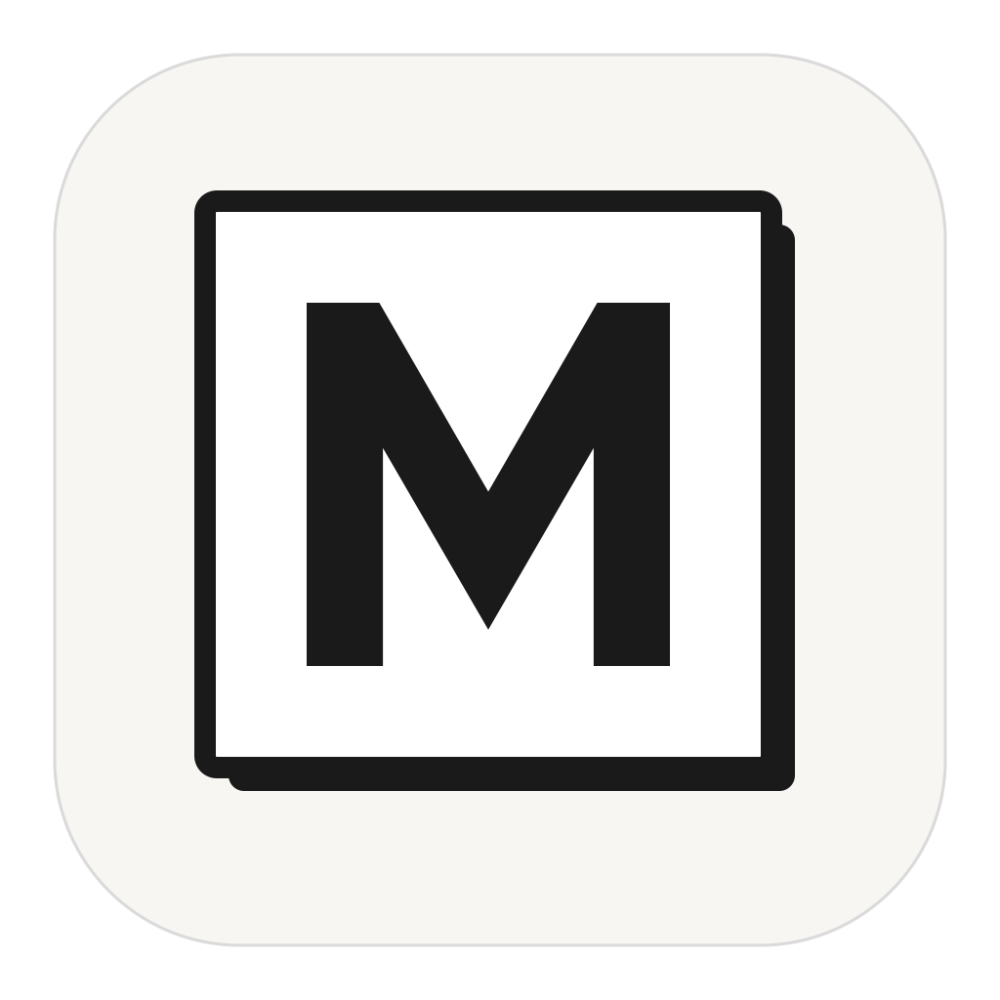
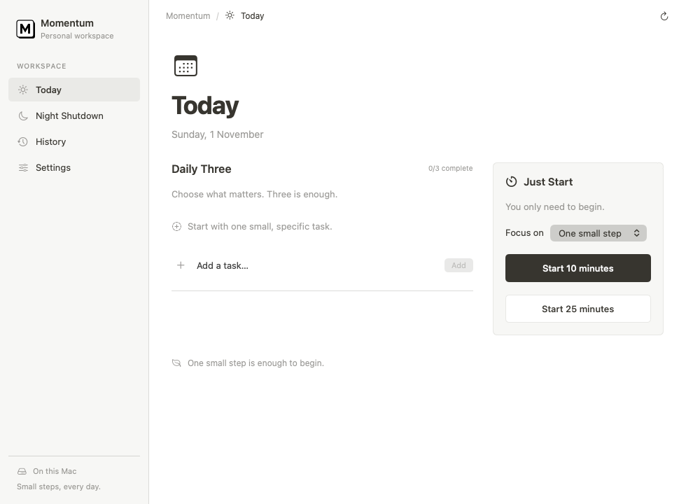

<p align="center">
  
</p>

<h1 align="center">Momentum</h1>

<p align="center">
  Choose what matters. Begin with ten minutes. Wind down at night.<br>
  A calm, native macOS workspace for your Daily Three and the small steps between.
</p>

<p align="center">
  <a href="#install">Download</a> ·
  <a href="#what-momentum-does">Features</a> ·
  <a href="docs/PRIVACY.md">Privacy</a> ·
  <a href="CONTRIBUTING.md">Contributing</a> ·
  <a href="SECURITY.md">Security</a> ·
  <a href="SPONSORS.md">Sponsor this project</a>
</p>

<p align="center">
  <a href="https://github.com/Kavishcan/momentum/releases/latest"></a>
  <a href="https://github.com/Kavishcan/momentum/actions/workflows/ci.yml"></a>
  
  
  
</p>

<p align="center">
  <a href="https://github.com/Kavishcan/momentum/releases/latest/download/Momentum-macos-universal.dmg"><strong>Download Momentum for Mac →</strong></a><br>
  <sub><a href="https://github.com/Kavishcan/momentum/releases/latest/download/Momentum-macos-universal.zip">ZIP alternative</a> · <a href="https://github.com/Kavishcan/momentum/releases/latest/download/SHA256SUMS">Checksums</a> · <a href="https://github.com/Kavishcan/momentum/releases">All releases</a></sub>
</p>

<h2 align="center">Sponsor this project</h2>

<table align="center">
  <tr>
    <td align="center" width="640">
      <br>
      <strong>Help keep Momentum moving.</strong><br>
      Support careful maintenance, accessible native design, and better Mac releases.<br><br>
      <a href="SPONSORS.md"><strong>Explore sponsorship →</strong></a><br>
      <sub>GitHub Sponsors setup is pending. No direct payments are enabled yet.</sub><br><br>
    </td>
  </tr>
</table>

<p align="center">
  <picture>
    <source media="(prefers-color-scheme: dark)" srcset="docs/assets/readme/today-dark.png">
    
  </picture><br>
  <sub>Native interface preview using test data. Appearance follows your Mac.</sub>
</p>

## A little progress, on purpose

Momentum gives your day three simple anchors: choose a few meaningful tasks, start one without waiting for motivation, and close the day with an intentional routine. It has a normal Mac window, a compact menu-bar panel, and a quiet document-style interface.

No account, subscription requirement, analytics, or cloud backend is needed to use the app. Your tasks and timer stay on your Mac.

## What Momentum does

### Daily Three

Choose up to three tasks for today. Add, rename, complete, or delete them. Completed tasks count toward the limit, so the list stays deliberate. Start a ten-minute focus session directly from a task, or revisit a previous day through History.

### Just Start

Choose a task—or simply **One small step**—and start **10 or 25 minutes**. Pause, resume, or end the session. The timer remains available from the menu bar when the main window is closed. Relaunching restores a paused session or reconciles an elapsed deadline. Completed sessions appear once in History; they do not silently complete your tasks.

### Night Shutdown

Set an evening reminder, explicitly save it, and make a routine that fits your life. Start with parking your phone away from bed, choosing tomorrow's first small step, and closing the laptop. Add or edit up to ten checklist steps. Checks reset at noon, keeping after-midnight wind-down in the same evening.

Notification permission is optional. **Send test** requests a reminder five seconds later; macOS Focus, sleep, and notification settings can affect delivery.

### History and local data

Review tasks by date, copy a past task into today, and see your latest 100 completed focus sessions. A versioned SQLite database holds tasks, routine checks, preferences, and timer state. Settings includes a database check and a consistent backup action. Earlier app data is imported with a retained snapshot and a transactional migration.

## Install

**Requires macOS 14 or later.** The published universal app contains Apple Silicon and Intel builds.

1. [Download the DMG](https://github.com/Kavishcan/momentum/releases/latest/download/Momentum-macos-universal.dmg).
2. Quit any older Momentum instance.
3. Open the DMG and drag **Momentum.app** into **Applications**.
4. Open Momentum from Applications, then eject the disk image.

A [ZIP](https://github.com/Kavishcan/momentum/releases/latest/download/Momentum-macos-universal.zip) is also available. Release checksums are included alongside the downloads.

Current releases are **ad-hoc signed development builds, not notarized by Apple**. If macOS blocks opening, follow the [launch troubleshooting guide](docs/TROUBLESHOOTING.md#macos-wont-open-the-app). No Homebrew cask or automatic updater is provided.

Updating the application keeps your local database. The main window opens from the Dock or **Open Momentum** in the M-square menu-bar panel. Closing a window keeps the app running; **Quit Momentum** exits it.

## Private by design

The app uses a local database, with no app account, analytics, tracking, or automatic cloud sync. Tasks are not placed in notification text. A notification request contains a generic reminder or completion message.

Files are stored under `~/Library/Application Support/Momentum/`. SQLite does not add application-level encryption; normal Mac account and disk protections apply. Backups and migration snapshots can retain older records. Read the [privacy notes](docs/PRIVACY.md) for storage, permissions, and safe sharing.

## Build it yourself

You need **Xcode 15+ / Swift 5.9+** with the macOS SDK. The app links the system SQLite library and has no third-party Swift packages.

```sh
git clone https://github.com/Kavishcan/momentum.git
cd momentum
swift test --scratch-path "$TMPDIR/MomentumTests"
bash scripts/build-app.sh release
open build/Momentum.app
```

Build a universal DMG and ZIP with:

```sh
bash scripts/build-dmg.sh universal
```

The [contributing guide](CONTRIBUTING.md) covers the source layout, tests, data safety, UI conventions, and release process. Local app builds use the installed app's data folder and identifier; create a backup before trying changes against personal data.

## Help and community

- [Report a bug or request a feature](https://github.com/Kavishcan/momentum/issues/new/choose).
- [Troubleshoot launch, reminders, and local data](docs/TROUBLESHOOTING.md).
- [Get support](SUPPORT.md).
- [Report a security issue privately](SECURITY.md).
- [Contribute code, documentation, or feedback](CONTRIBUTING.md).
- [Sponsor Momentum](SPONSORS.md), or help by testing a release and sharing clear feedback.

Momentum is early in development. Suggestions and focused fixes are welcome. It supports intentional routines; it does not block iPhone/Mac apps, control Screen Time, or enforce bedtime.

## Project notes

| Document | What it covers |
| --- | --- |
| [Release notes](RELEASE_NOTES.md) | Current release and installation details |
| [Design](DESIGN.md) | Layout, colors, type, interactions, and accessibility |
| [Architecture](ARCHITECTURE.md) | SQLite, migration, timer, notifications, and packaging |
| [Validation](VALIDATION.md) | Checks performed and remaining manual verification |
| [Privacy](docs/PRIVACY.md) | Data storage, notifications, and permissions |
| [Contributing](CONTRIBUTING.md) | How to propose and validate changes |
| [Security](SECURITY.md) | Private disclosure contact and scope |
| [Sponsorship](SPONSORS.md) | Current funding status and ways to support the work |

A project license has not yet been published.

<p align="center"><sub>Built and maintained by <a href="https://github.com/Kavishcan">Kavishcan</a>.</sub></p>
